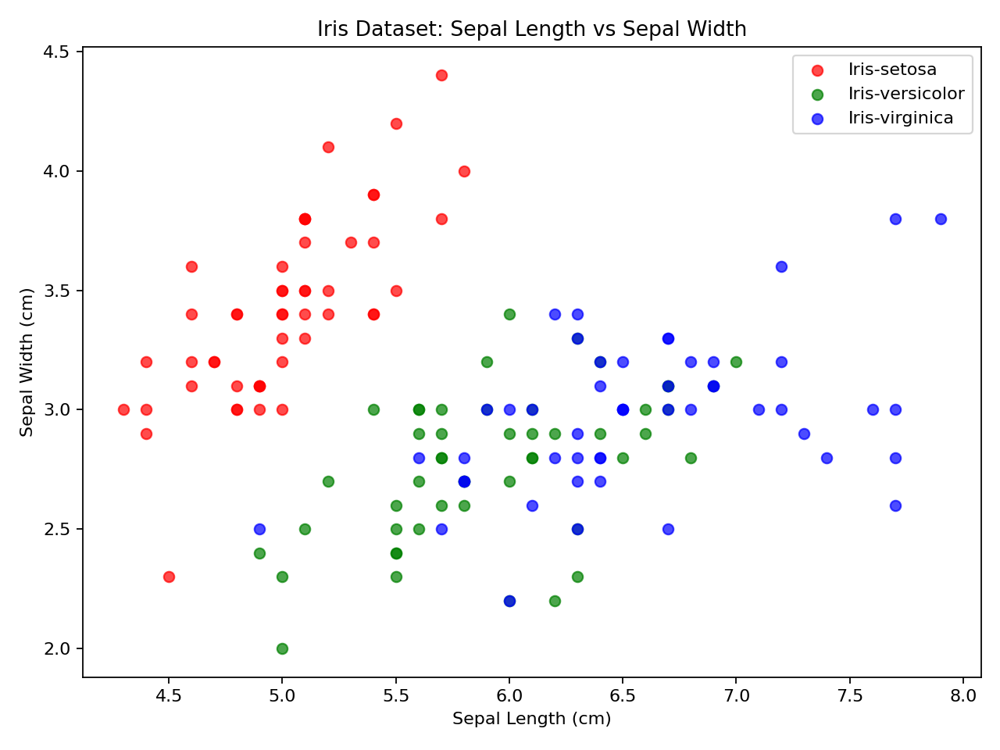

# Iris Flower Classification

A Python machine learning project that classifies Iris flowers into **Setosa**, **Versicolor**, or **Virginica** using four botanical measurements.

The project combines object-oriented programming, data visualization, Logistic Regression, and a simple Tkinter desktop interface.

## Features

- Loads the classic Iris dataset from an Excel file
- Explores the dataset with Pandas
- Visualizes Sepal Length vs Sepal Width
- Uses four features: sepal length, sepal width, petal length, and petal width
- Trains a Logistic Regression classifier
- Uses an 80/20 stratified train-test split
- Provides an interactive Tkinter GUI for predictions
- Achieves **96.67% test accuracy** with the included dataset and split

## Visualization



## Technologies

- Python
- Pandas
- Matplotlib
- Scikit-learn
- Tkinter
- OpenPyXL

## Project Structure

```text
iris-flower-classification/
├── README.md
├── main.py
├── requirements.txt
├── .gitignore
├── data/
│   └── iris.xlsx
├── screenshots/
│   └── visualization.png
└── docs/
    └── Iris_Classification_Presentation.pdf
```

## Installation

Clone the repository:

```bash
git clone https://github.com/ayhq1/iris-flower-classification.git
cd iris-flower-classification
```

Install the dependencies:

```bash
pip install -r requirements.txt
```

Run the project:

```bash
python main.py
```

The program displays the dataset visualization, trains and evaluates the model, and then launches the Tkinter prediction interface.

## Model

The classifier uses **Logistic Regression** with the following input features:

- Sepal Length
- Sepal Width
- Petal Length
- Petal Width

The included implementation uses an 80% training and 20% testing split with `random_state=42` and stratification by species.

## Documentation

A cleaned version of the original project presentation is available in:

`docs/Iris_Classification_Presentation.pdf`

## Future Improvements

- Add a confusion matrix and classification report
- Compare Logistic Regression with other classifiers
- Add input-range validation to the GUI
- Deploy a web version using Streamlit
